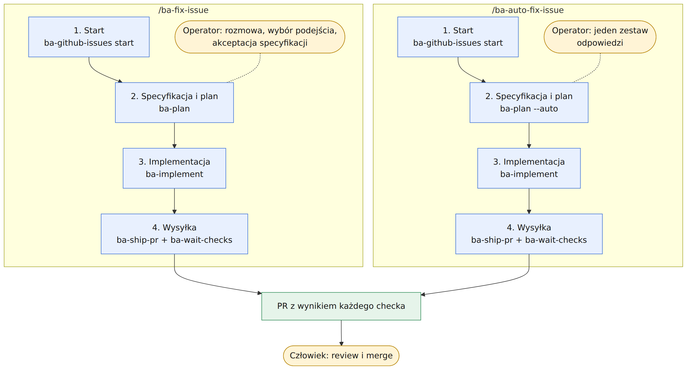
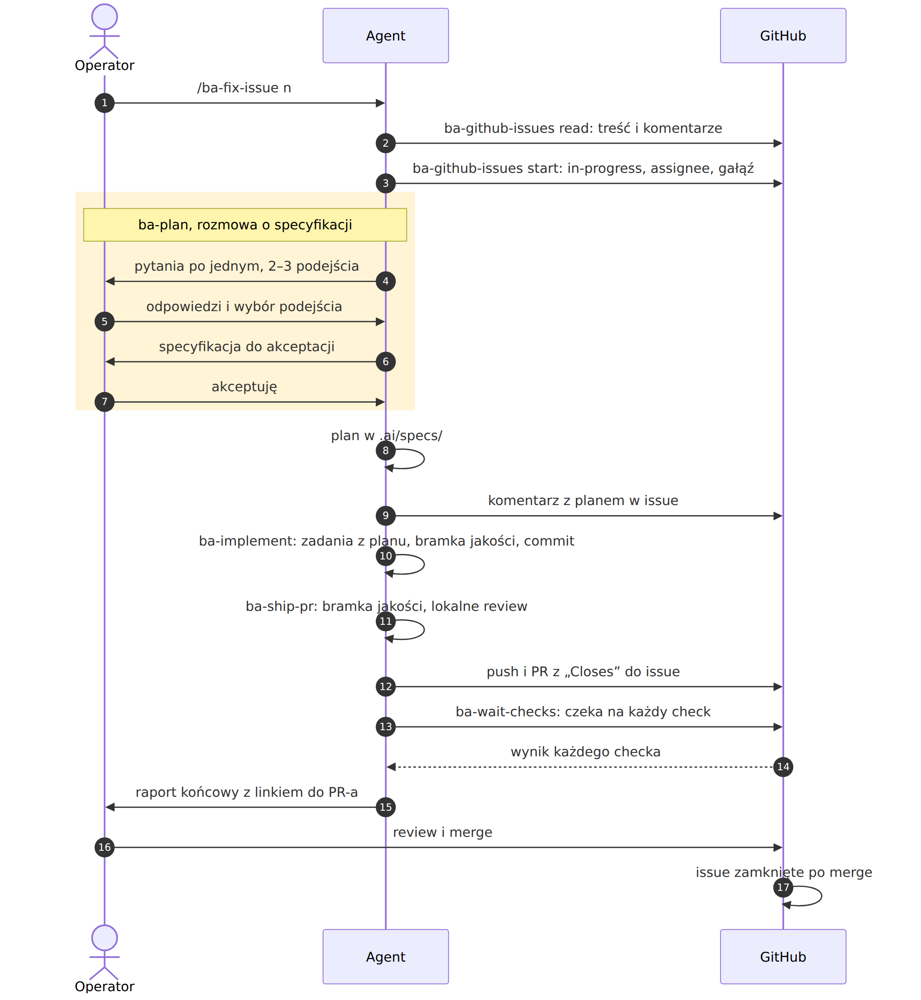
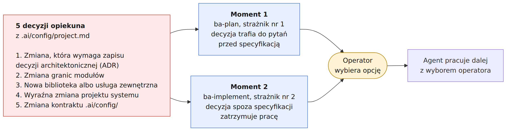
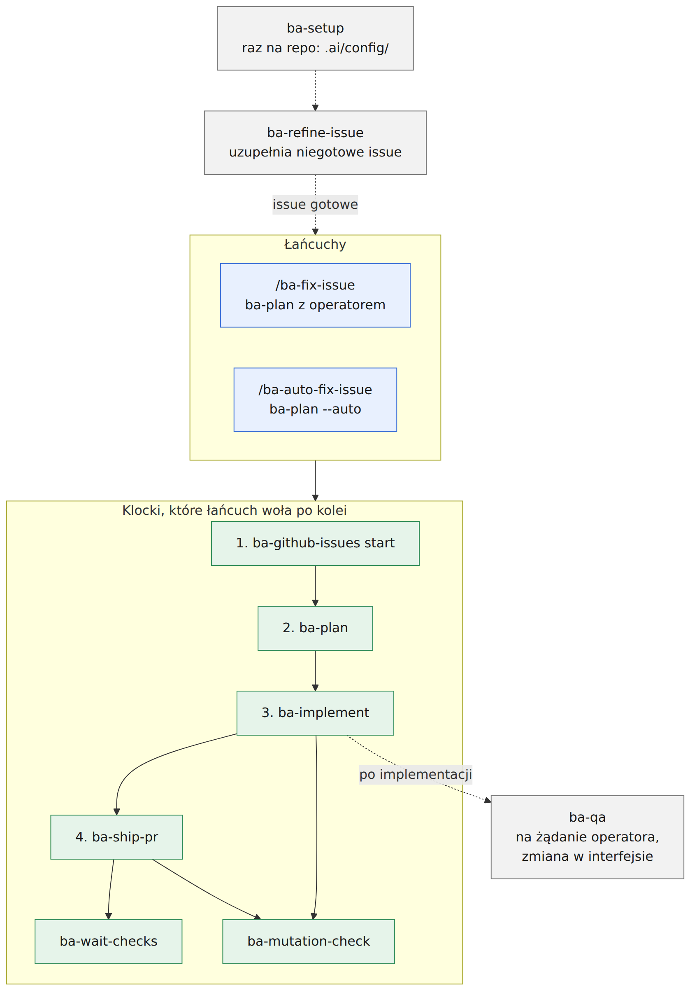

# skills

Skille `ba-*` prowadzą zadanie z GitHub Issues od pomysłu do PR-a z zielonymi checkami. Agent czyta je z plików `SKILL.md`.

## Wymagania

- `gh`, czyli CLI GitHuba, zalogowane do repozytorium. Używają go skille issue i PR-ów.
- Plugin `code-review` z Claude Code. Na nim stoi lokalne review w `ba-ship-pr`.
- Narzędzia przeglądarki Playwright MCP. Potrzebuje ich tylko `ba-qa`.

## Instalacja

```bash
npx skills add mkurc1/skills
```

Polecenie uruchamiasz w katalogu głównym swojego repozytorium.

## Aktualizacja

```bash
npx skills update
```

Repo nie ma wydań ani tagów. Aktualizacja bierze najnowszy stan gałęzi `main`.

## Pierwszy krok w nowym repozytorium

Uruchom [`ba-setup`](skills/ba-setup/SKILL.md).

- Skille czytają fakty o projekcie z katalogu `.ai/config/`.
- `ba-setup` zakłada ten katalog po krótkiej rozmowie.
- Bez `.ai/config/` pozostałe skille się zatrzymują i odsyłają do `ba-setup`.
- W repo skonfigurowanym wcześniej uruchom `ba-setup` ponownie. Skill dopisze brakujący wpis `.ai/scratch/` do `.gitignore`.

## Skille

| Skill | Co robi |
|---|---|
| [`ba-setup`](skills/ba-setup/SKILL.md) | Zakłada `.ai/config/` i opis procesu dla nowego repozytorium. Dopisuje `.ai/scratch/` do `.gitignore`. Po zgodzie kasuje etykiety spoza konfiguracji. |
| [`ba-github-issues`](skills/ba-github-issues/SKILL.md) | Czyta, zakłada, przejmuje, komentuje i zamyka issue. |
| [`ba-refine-issue`](skills/ba-refine-issue/SKILL.md) | Uzupełnia szkic issue w rozmowie, aż spełni warunki gotowości. |
| [`ba-plan`](skills/ba-plan/SKILL.md) | Pisze specyfikację i plan dla issue przed kodem. |
| [`ba-implement`](skills/ba-implement/SKILL.md) | Wykonuje plan zadanie po zadaniu i commituje. |
| [`ba-ship-pr`](skills/ba-ship-pr/SKILL.md) | Sprawdza gałąź, wystawia PR i prowadzi go do zielonych checków. |
| [`ba-wait-checks`](skills/ba-wait-checks/SKILL.md) | Czeka na wynik każdego sprawdzenia PR-a. |
| [`ba-mutation-check`](skills/ba-mutation-check/SKILL.md) | Sprawdza, że test regresyjny pada po cofnięciu poprawki. |
| [`ba-qa`](skills/ba-qa/SKILL.md) | Testuje zmianę w przeglądarce według specyfikacji. |
| [`ba-fix-issue`](skills/ba-fix-issue/SKILL.md) | Prowadzi issue do PR-a. Specyfikację piszesz razem z agentem. |
| [`ba-auto-fix-issue`](skills/ba-auto-fix-issue/SKILL.md) | Prowadzi issue do PR-a. Agent pyta raz, potem pracuje sam. |

## Proces

Skille składają się w proces od issue do merge'a. Źródła diagramów i sposób ich renderowania: [`docs/diagrams/`](docs/diagrams/README.md).

### Dwie drogi przez 4 etapy



Oba łańcuchy przechodzą te same 4 etapy i kończą się PR-em z wynikiem każdego checka. W `/ba-fix-issue` operator współtworzy i akceptuje specyfikację, w `/ba-auto-fix-issue` odpowiada na pytania o braki i decyzje. Pozostałe etapy pytają go tylko przy zatrzymaniu.

### `/ba-fix-issue` krok po kroku



Operator wywołuje łańcuch i współtworzy specyfikację. Resztę, aż do raportu z PR-em, agent robi sam i pyta tylko przy zatrzymaniu, a review i merge zostają po stronie człowieka.

### Gdzie decyduje operator



Agent nigdy nie podejmuje sam decyzji opiekuna. Pyta o każdą w `ba-plan` przed specyfikacją albo staje w `ba-implement`, gdy decyzja wyjdzie dopiero przy kodzie.

### Klocki i łańcuchy



Łańcuch to skill, który woła klocki w ustalonej kolejności. `ba-setup` i `ba-refine-issue` działają przed łańcuchem, a `ba-qa` uruchamiasz osobno po implementacji.

## Testy

```bash
uv sync
uv run pytest
```

Testy pilnują kontraktów między skillami i szablonów `ba-setup`. CI uruchamia je razem z `ruff` i próbną instalacją przez `npx skills add`.
